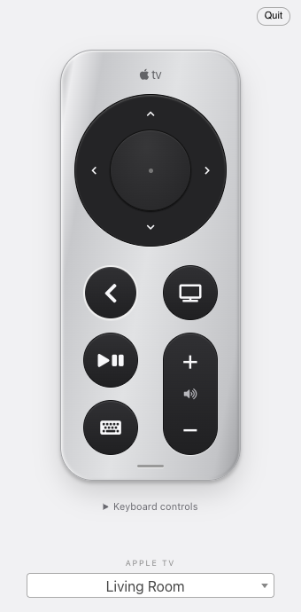

# ATV Desktop Remote
A simple menubar app that allows you to control an Apple TV from your desktop

## Installation 

Build this fork from source using the instructions below. Homebrew (`brew install atv-remote`) and [upstream releases](https://github.com/bsharper/atv-desktop-remote/releases) install the original app.

## This fork

This fork uses a silver Siri Remote layout with a circular clickpad, Back and TV buttons, play/pause, a volume rocker, and a keyboard button. The keyboard button takes the place of the physical remote's mute button; the current Apple TV library does not expose mute or power commands.

## Usage

| Key | Action |
| --- | --- |
| W / A / S / D | Up / Left / Down / Right |
| Space or Enter | Select |
| Q / E | Volume down / up |
| R | Back |
| F | TV |
| Shift + F | Hold TV / Control Center |
| P | Play/pause |
| K | Open text keyboard |
| H | Hide window |

Arrow keys, Escape/Backspace for Back, T for TV, and +/- for volume still work. Hold Option/Alt to reveal shortcuts on the remote. Shortcuts only operate while the remote window has focus and do not intercept typing in fields or native control activation. The old triple-Q quit shortcut has been removed.

Click a button to send a command; hold TV to open Control Center. The remote's keyboard button opens the separate text-entry window.

## Registered devices and upgrades

Pairings live in Chromium `localStorage` in the Electron user-data profile, outside the application bundle:

- `remote_credentials`: saved devices and pairing credentials, indexed by display name.
- `atvcreds`: the currently selected device's credentials.

The normal profile locations are:

- macOS: `~/Library/Application Support/ATV Remote/`
- Windows: `%APPDATA%\ATV Remote\`
- Linux: `$XDG_CONFIG_HOME/ATV Remote/` (normally `~/.config/ATV Remote/`)

The local-storage database is under `Local Storage/leveldb/`. To confirm the exact profile on a particular installation, open the renderer's developer console and run `require('@electron/remote').app.getPath('userData')`. The `MYPATH` directory in `main.js` was used for legacy helper files; it is not what selects Electron's local-storage profile.

This fork preserves the upstream package name (`atv-mac-remote`), product name (`ATV Remote`), bundle ID (`com.electron.atvMacRemote`), page path, and storage keys. Replacing an existing installation for the same OS user should keep its registered devices. Quit the app before replacing it, retain the user-data directory, and avoid **Clear saved data**. A different OS user or a fresh computer has a separate profile.

### Move registrations to another machine

1. Install this fork on the original machine, retaining its existing user-data profile.
2. Right-click the menu-bar/tray icon and choose **Export paired devices…**.
3. Transfer the exported JSON privately to the destination machine.
4. On the destination, choose **Import paired devices…** from the tray menu.

Import merges devices, preserves existing registrations and the current selection, and gives a different device with the same display name an `imported` suffix. It reloads the remote to refresh the device list. Exports include private pairing credentials in plaintext; store them securely and do not commit them to Git. They contain device network addresses, so the destination must be able to reach the Apple TVs. A changed address or revoked pairing may still require reconnection or pairing again.

For a full-profile backup, quit the app and copy the entire user-data directory. Use export/import for moving between machines rather than copying an individual LevelDB file.

 

  

 
 
 
 ## Running

 1. Run `npm ci --legacy-peer-deps`, then `npm ci --prefix app --legacy-peer-deps`
 2. Run `npm start`
 3. The application runs in the menubar. Look for a tiny remote icon and click on it. Right-click for more options.
 4. The first time the app runs it will need to pair with an Apple TV. You can pair with more than one.
 5. Press `Cmd+Shift+R` to open the application from anywhere. On Windows its `Win+Shift+R`

## Building

1. `electron-builder` is used to create a standalone application.
2. Run `npm run build-arm` for Apple silicon, `npm run build` for the host Mac architecture, or `npm run build:win` for Windows. Distributable builds need appropriate signing/notarization credentials.
3. Run `npm test` for keyboard and device-transfer tests. `npm run test:ui` runs an offscreen Electron smoke test with a temporary profile, mock devices, and no Apple TV network traffic.

## Notes

This is cobbled together from a few projects I've worked on. It works well enough for me for daily use, so I figured others might like it. 

This project is built using [pyatv.](https://pyatv.dev/)

